<p align="center">
  
</p>

<h1 align="center">Loop — close the loop on mutual transfers</h1>

<p align="center">
  <b>Transfer portals only match pairs. Loop finds the 3- and 4-way chains that pairs miss,<br>
  and gets everyone in the chain to commit at once — before anyone's posting changes.</b>
</p>

<p align="center">
  <a href="https://github.com/TusharTechs/loop-transfers/actions/workflows/tests.yml"></a>
  <a href="https://github.com/TusharTechs/loop-transfers/actions/workflows/analyze.yml"></a>
  <a href="https://github.com/TusharTechs/loop-transfers/actions/workflows/format.yml"></a>
  
  
  
  <a href="LICENSE"></a>
</p>

## Links

| What | Link |
|---|---|
| **Live app** (web, works on phones) | https://loop-transfers.serverpod.space/app/ |
| **Demo accounts** (no email needed) | `judge1@example.com` … `judge10@example.com` · password `LoopDemo-2026!` → then **Try it in one tap** (or **Try the sandbox again** on an account someone already used) |
| **Website** (server-rendered, live numbers) | https://loop-transfers.serverpod.space/ |
| **Live market** (no account needed) | App → **Live market** tab |
| **Loop Lab** — run the engine yourself | App → **How it works** tab |
| **Example verification page** (what a transfer office sees) | https://loop-transfers.serverpod.space/v/TD28-6H3F |
| **Example joint transfer application** | https://loop-transfers.serverpod.space/v/TD28-6H3F/application |
| **Android APK** | [Latest release](https://github.com/TusharTechs/loop-transfers/releases/latest) (`app-arm64-v8a-release.apk` fits most phones) |
| **Demo video** (1:50, narrated) | _YouTube link added at submission_ · also in the repo: [docs/demo/loop-demo.mp4](docs/demo/loop-demo.mp4) |
| **API** (Serverpod) | https://loop-transfers.api.serverpod.space/ |
| Design notes · Serverpod feedback · Submission notes | [DESIGN.md](docs/DESIGN.md) · [FEEDBACK.md](docs/FEEDBACK.md) · [SUBMISSION.md](docs/SUBMISSION.md) |

<p align="center">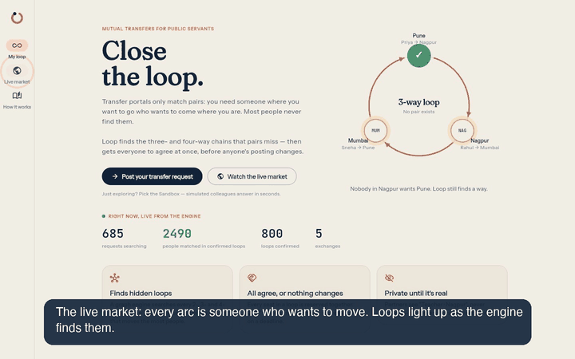</p>

## Contents

[The problem](#the-problem) · [What Loop does](#what-loop-does) ·
[How much better than pairs](#how-much-better-than-pairs) ·
[Architecture](#architecture) · [How Serverpod is used](#how-serverpod-is-used) ·
[The engine](#the-engine) · [Project structure](#project-structure) ·
[Run it locally](#run-it-locally) · [Tests](#tests) · [Deployment](#deployment) ·
[Roadmap](#roadmap) · [AI tools](#ai-tools-disclosure) · [Licence](#licence)

---

## The problem

Millions of public-sector employees in India — teachers, nurses, police
constables, postal staff — can only change their posting through a
**mutual transfer**: they must find someone in the same cadre who sits where
they want to go *and* wants to come where they are. State portals match
**pairs** only (e.g. Bihar's e-Shiksha Kosh, Assam's Swagat Satirtha, whose
first round alone moved 9,004 employees).

Pairs are rare. A teacher in Pune whose spouse works in Nagpur can wait years,
because nobody in Nagpur wants Pune. But a teacher in Nagpur may want Mumbai,
and a teacher in Mumbai may want Pune. That **3-way loop** solves three
families at once — and today nobody can see it.

The same structure powers kidney paired donation, where cycle exchanges
(Roth & Shapley, Nobel 2012) dramatically increased matches. Loop brings it to
people who need to trade places.

## What Loop does

1. **Post where you are and where you would go** — up to five ranked places,
   exact districts or "anywhere within 50 km".
2. **The engine searches every loop** and proposes non-overlapping 2-, 3- and
   4-way loops that move the most people *in expectation*.
3. **Everyone commits together.** All seats are reserved at once; answers
   stream live to everyone in the loop; one decline releases everyone (and that
   move is never proposed again); silence expires on a deadline.
4. **Then you meet.** Only when everyone has said yes are names and contacts
   revealed — with a public **verification page** for the transfer office and a
   printable **joint transfer application**.

| Proposal: answers arrive live | Confirmed: reveal, code, documents, map |
|---|---|
| 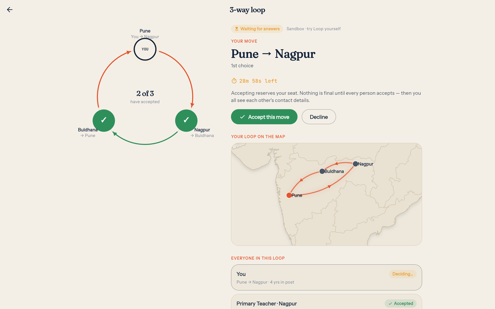 | 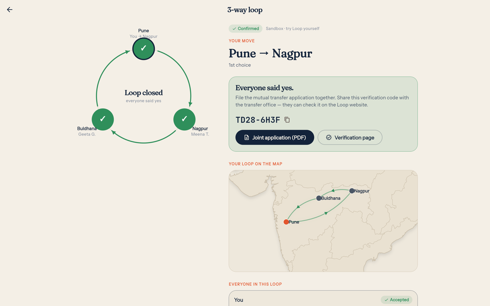 |

| Joint application, ready to sign | Verification for the transfer office |
|---|---|
| 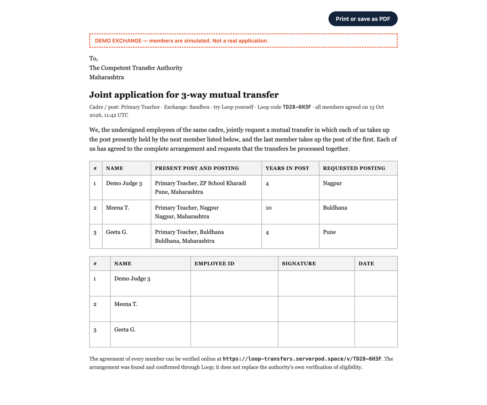 | 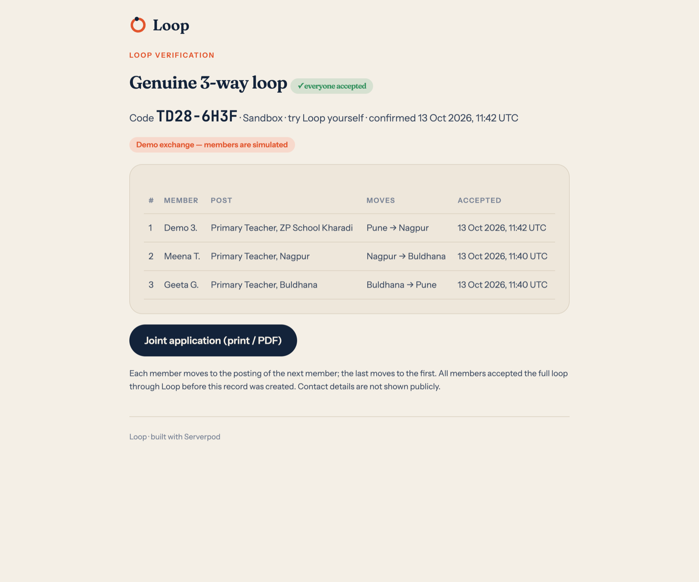 |

| Welcome | Request, with one-tap try | Dashboard: a loop found you |
|---|---|---|
| 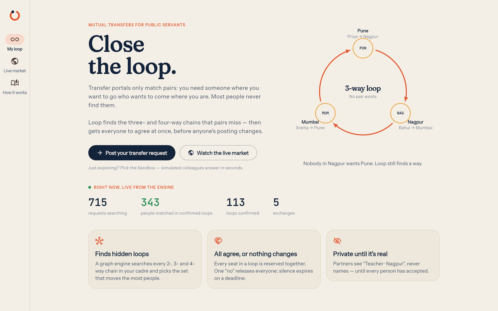 | 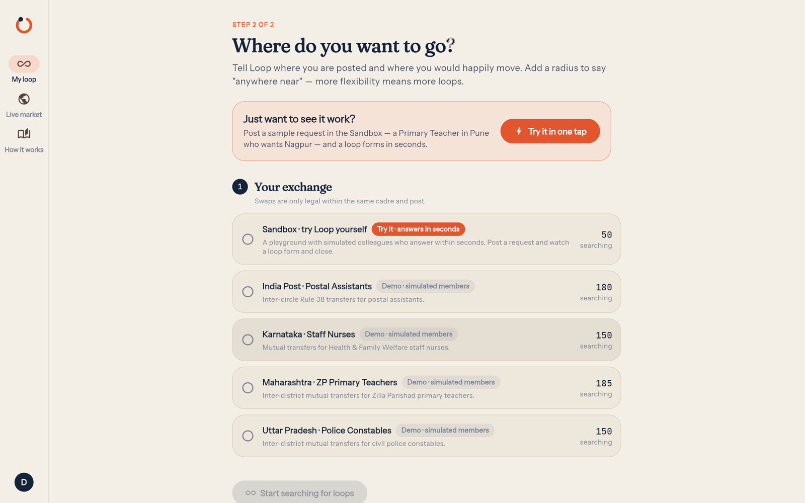 | 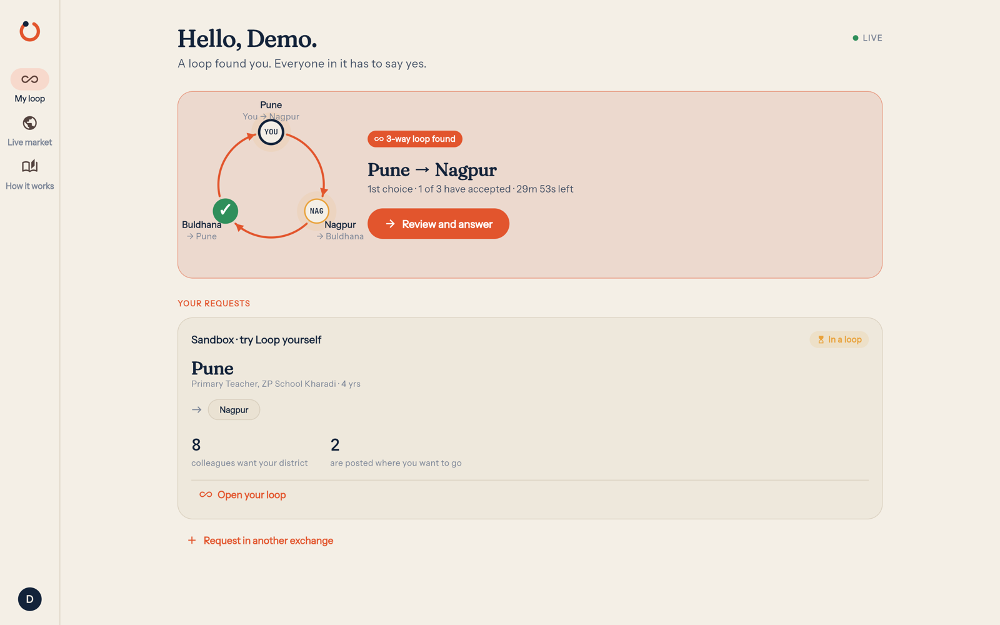 |

## How much better than pairs?

Every engine run also solves the same requests with pairs only, so the
comparison is measured, not claimed. The **Loop Lab** lets anyone run the real
engine on a synthetic cadre:

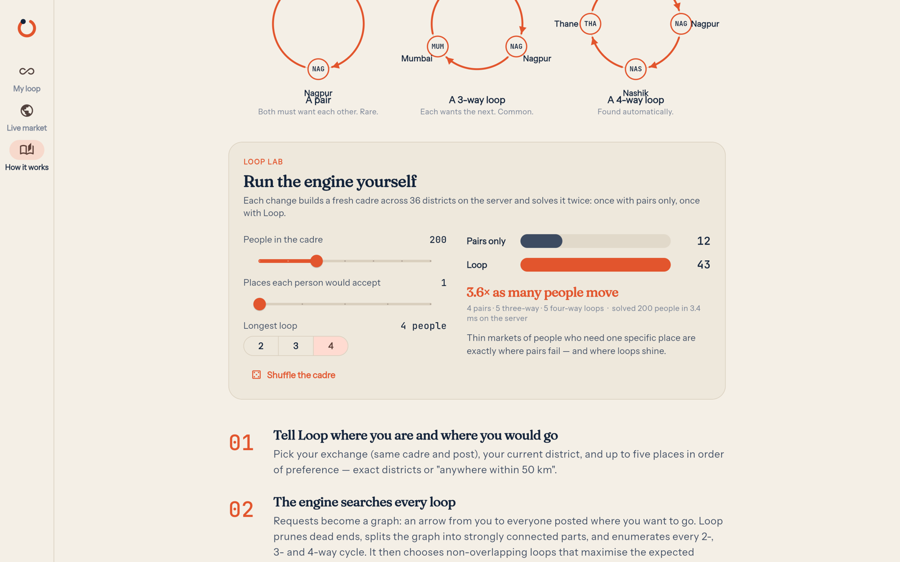

| Cadre | Places each accepts | Pairs only | Loop |
|---|---|---|---|
| 100 people | 1 | 4 | **19** (4.8×) |
| 400 people | 1 | 54 | **161** (3.0×) |
| 400 people | 3 | 208 | **315** (+51%) |
| 1,500 people | 3 | 1,176 | **1,247** (+6%) |

Loops help most where people are stuck today: thin markets of people who need
one specific place. Loop never moves fewer people than pairs — it starts from
the best pairs-only solution and adds loops for the people pairs leave behind.

## Architecture

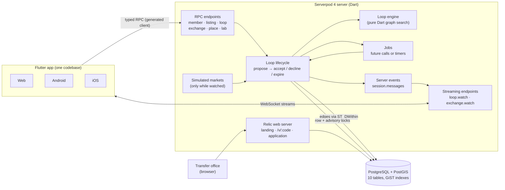

**One loop, end to end**

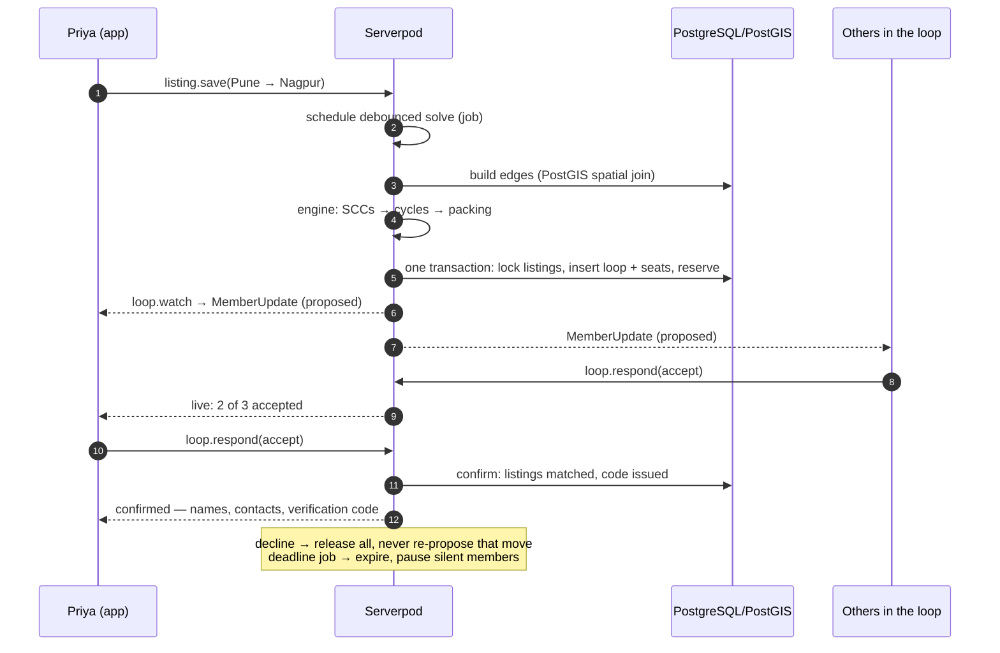

## How Serverpod is used

Loop is not a CRUD app behind a static page — the server *is* the product.

| Serverpod feature | Where | What it does in Loop |
|---|---|---|
| **Models + ORM** (`*.spy.yaml`) | `loop_server/lib/src/loop/models/` | 10 tables plus typed views, stream messages and serializable exceptions |
| **PostGIS** (`GeographyPoint`, GiST) | `services/edges.dart` | The "who would accept whom" graph is **one spatial join** using `ST_DWithin` on geography for radius wishes |
| **Transactions, row locks, advisory locks** | `services/loop_service.dart` | Propose / accept / decline / expire are single transactions with `FOR UPDATE` locks; `pg_try_advisory_xact_lock` keeps one engine run per exchange — a person can never be in two live loops. All loops of a run are written in four batched queries |
| **Future calls** | `loop_future_calls.dart`, `services/jobs.dart` | Deadlines, debounced re-solves, simulated replies and a recurring sweep — durable future calls when available, an automatic in-process fallback where they are not (e.g. Cloud Starter), with the database as the source of truth and recovery after restarts |
| **Streaming endpoints + server events** | `endpoints/*`, `session.messages` | `loop.watch()` pushes each member's loop changes; `exchange.watch()` feeds the live map and, by counting viewers, keeps demo markets alive only while watched |
| **Authentication** (`serverpod_auth_idp`) | `server.dart`, `services/seeder.dart` | Email sign-up; every member endpoint `requireLogin`; contact fields are `serverOnly`; demo accounts created with the email IdP admin API |
| **Web server (Relic) + templates** | `lib/src/web/routes/loop_pages.dart` | Landing page with live totals, `/v/<code>` verification and `/v/<code>/application` printable joint application; also serves the Flutter web app |
| **Stateless compute endpoint** | `endpoints/lab_endpoint.dart` | Loop Lab builds and solves a synthetic cadre on every slider move |
| **Testing** (`withServerpod`, embedded Postgres) | `loop_server/test/` | Engine invariants, the whole lifecycle, PostGIS radius matching, privacy, idempotency, double-solve safety, live stream delivery, Lab, simulation |
| **Serverpod Cloud** | `loop_server/scloud.yaml` | API, web, database and auth email; pre-deploy hooks build the web app |

## The engine

`loop_server/lib/src/engine/` is pure Dart, independent of the server:

1. **Prune** people who can never be on a cycle; split the rest into
   **strongly connected components** (iterative Tarjan).
2. **Enumerate cycles** up to the exchange's maximum size, each exactly once.
   In dense markets many people are interchangeable, so the search expands the
   most-preferred successors first and caps loops per person — bounded and fast.
3. **Score by expected people moved**: a loop of *k* only happens if all *k*
   accept, so `score = k · p^k · (1 + preference)` — two robust pairs beat one
   fragile 4-way loop over the same people.
4. **Pack** non-overlapping loops, starting from the exact best pairs-only
   solution, then improve locally with a bounded exact search.
5. **Report the pairs-only baseline**, computed exhaustively on the same graph.

`dart run tool/bench.dart`: a random 20,000-person market solves in ~50 ms on a
laptop; the Lab's dense 1,500-person cadre in ~0.25 s.

**Privacy by design.** Before confirmation partners appear only as
"Primary Teacher · Nagpur"; who declined is never revealed; contact details are
server-only and sent only within a loop everyone has accepted.

**Demo data, honestly labelled.** Real exchanges start empty, so Loop ships
simulated markets for four cadres plus a Sandbox, labelled "simulated members"
everywhere (a demo loop's joint application is stamped *DEMO*). Real people are
always given priority over simulated ones by the engine.

## Project structure

```
loop/
├── loop_server/                    Serverpod server
│   ├── bin/main.dart               entry point
│   ├── lib/server.dart             auth, web routes, scheduler, seeding
│   ├── lib/src/engine/             loop engine (pure Dart): graph, SCCs, cycles, packing
│   ├── lib/src/loop/
│   │   ├── models/                 *.spy.yaml data models (tables, views, events)
│   │   ├── endpoints/              member, listing, loop, exchange, place, lab
│   │   ├── services/               loop_service (lifecycle), edges (PostGIS), jobs,
│   │   │                           market, bots + simulation (demo markets), seeder, views
│   │   └── loop_future_calls.dart  deadline, solve, sweep, simulated reply
│   ├── lib/src/web/routes/         landing, verification, joint application
│   ├── web/templates/ · web/static/  server-rendered pages and CSS
│   ├── assets/data/                763 Indian districts (GeoNames)
│   ├── migrations/                 database migrations
│   ├── test/unit · test/integration  engine and end-to-end server tests
│   ├── tool/bench.dart             engine benchmark
│   ├── tool/smoke.dart             end-to-end check against any running server
│   └── scloud.yaml                 Serverpod Cloud project + pre-deploy hooks
├── loop_client/                    generated, type-safe client (do not edit)
├── loop_flutter/                   Flutter app (web, Android, iOS)
│   ├── lib/screens/                welcome, profile, request, dashboard, loop, market, about
│   ├── lib/widgets/                loop ring, India map painter, Loop Lab, place picker
│   ├── lib/state/app_state.dart    signed-in state + live member stream with reconnect
│   └── assets/geo/                 India map outlines (Natural Earth, India POV)
├── docs/                           design, data sources, feedback, submission, screenshots
└── .github/                        CI (tests, analyze, format) and issue templates
```

## Run it locally

Everything runs with **Flutter + the Serverpod CLI**. No Docker is needed:
Serverpod 4 downloads and runs an embedded PostgreSQL (with PostGIS) for you.

### 1. Install the prerequisites

| | macOS | Windows | Linux |
|---|---|---|---|
| **Git** | `xcode-select --install` | [git-scm.com](https://git-scm.com/download/win) or `winget install Git.Git` | `sudo apt install git` (or your distro's package) |
| **Flutter 3.44.4+** (includes Dart) | [Install guide](https://docs.flutter.dev/get-started/install/macos) or `brew install --cask flutter` | [Install guide](https://docs.flutter.dev/get-started/install/windows) (unzip, add `flutter\bin` to `PATH`) | [Install guide](https://docs.flutter.dev/get-started/install/linux) or `sudo snap install flutter --classic` |
| **Chrome** (for the web app) | ✓ | ✓ | ✓ |

Check with `flutter doctor` (only the Chrome/web line is required to run the
web app; Android Studio / Xcode are only needed for mobile builds).

### 2. Install the Serverpod CLI

```bash
dart install serverpod_cli
serverpod version        # should print 4.0.x
```

`dart install` puts the `serverpod` command in Dart's install folder and
prints its location. If `serverpod` is not found, add that folder to your
`PATH` (typical locations below):

| OS | Folder to add to `PATH` |
|---|---|
| macOS | `~/Library/Application Support/Dart/install/bin` |
| Linux | `~/.local/state/Dart/install/bin` (or `$XDG_STATE_HOME/Dart/install/bin`) |
| Windows | `%LOCALAPPDATA%\Dart\install\bin` (PowerShell: `$env:LOCALAPPDATA\Dart\install\bin`) |

### 3. Clone and start

macOS / Linux:

```bash
git clone https://github.com/TusharTechs/loop-transfers.git
cd loop-transfers
flutter pub get
cd loop_server
serverpod start
```

Windows (PowerShell):

```powershell
git clone https://github.com/TusharTechs/loop-transfers.git
cd loop-transfers
flutter pub get
cd loop_server
serverpod start
```

`serverpod start` starts the database, applies migrations, runs the server and
opens the Flutter web app with full-stack hot reload. On first start Loop seeds
763 districts, the exchanges, the simulated markets and the five demo accounts
(`judge1@example.com` … `judge10@example.com`, password `LoopDemo-2026!`).

**Without the interactive runner** (any OS): build the web app once, then run
the server.

```bash
cd loop_server
serverpod run flutter_build
dart run bin/main.dart --apply-migrations
```

Open <http://localhost:8082/app/> (app) and <http://localhost:8082/> (website).
In development the email sign-up code is printed in the server log.

### 4. Mobile (optional)

```bash
cd loop_flutter
# Android emulator talking to your local server:
flutter run -d android --dart-define=SERVER_URL=http://10.0.2.2:8080/
# iOS simulator (macOS with Xcode):
flutter run -d ios --dart-define=SERVER_URL=http://localhost:8080/
# Or use the live server from a real phone:
flutter run --dart-define=SERVER_URL=https://loop-transfers.api.serverpod.space/
```

Release APKs: `flutter build apk --release --split-per-abi --dart-define=SERVER_URL=https://loop-transfers.api.serverpod.space/`

### Troubleshooting

| Symptom | Fix |
|---|---|
| `serverpod: command not found` | Add the Dart install folder (table above) to `PATH`, open a new terminal |
| Embedded PostgreSQL cannot start (unusual platforms or corporate networks) | Use Docker instead: `cd loop_server && docker compose up -d`, then remove `dataPath` from `config/development.yaml` |
| Port 8080/8082/8090 already in use | Stop the other process or change ports in `loop_server/config/development.yaml` |
| Web app shows "build the Flutter app" | Run `serverpod run flutter_build` in `loop_server` |

## Tests

```bash
cd loop_server
dart test                 # unit + integration tests on an embedded PostgreSQL
dart run tool/bench.dart  # engine benchmark
dart run tool/smoke.dart https://loop-transfers.api.serverpod.space/   # end-to-end on a live server
```

CI runs the tests, the analyzer (server and app) and formatting on every push.

## Deployment

The live app runs on **Serverpod Cloud**:

```bash
cd loop_server
serverpod cloud deploy
```

`scloud.yaml` runs `serverpod generate` and builds the Flutter web app before
each upload. Secrets (`serviceSecret`, `emailSecretHashPepper`,
`jwtHmacSha512PrivateKey`, `jwtRefreshTokenHashPepper`) are set with
`serverpod cloud password set`.

## Roadmap

- Notifications by email, SMS or WhatsApp when a loop finds you
- Hindi, Marathi and Kannada UI
- Shift-swap exchanges for hospitals (same engine, time slots instead of places)
- Employer verification of cadre and posting; submission to state transfer portals

## AI tools disclosure

Product direction and decisions — the problem to solve, the users, the scope,
platforms and priorities — are by Tushar Agarwal. AI tools were used as
follows:

- **Claude Code (Anthropic, Claude Opus 5.5)** in the Claude desktop app —
  research on the hackathon and existing solutions, architecture, writing and
  refactoring the Dart/Flutter code, tests, debugging, deployment to Serverpod
  Cloud, documentation, the app icon (drawn with a Python script),
  automated screenshots and the scripted screen recording of the demo video.
- **Kokoro-82M** (open-weight text-to-speech, Apache 2.0, voice `af_heart`) —
  the demo video's voiceover, run locally from a script written by Claude Code.
- **Claude Sonnet sub-agents** (via Claude Code) — background research
  (other hackathon entries, Serverpod 4 capabilities) and preparing the
  GeoNames / Natural Earth datasets.
- **Serverpod agent skills and project templates** (generated by
  `serverpod create` / App Studio) — reference guidance for Serverpod APIs.

No AI runs inside the product: matching is done by the deterministic loop
engine described above.

## Licence

[MIT](LICENSE) © 2026 Tushar Agarwal.

District coordinates © GeoNames (geonames.org), CC BY 4.0. Map outlines:
Natural Earth (public domain), India point of view. See
[docs/DATA_SOURCES.md](docs/DATA_SOURCES.md).
