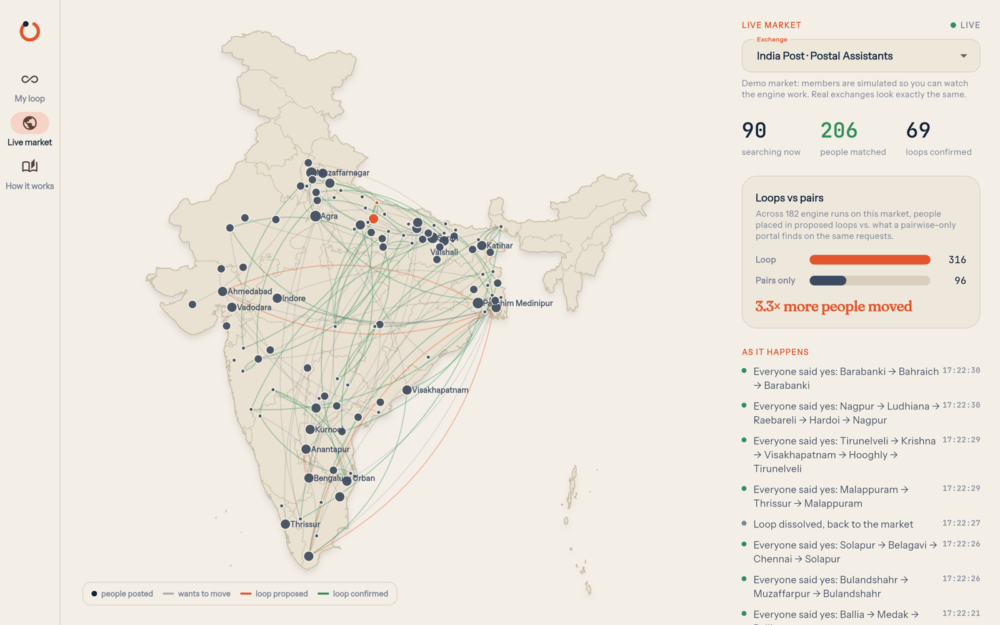

# Loop — close the loop on mutual transfers

**Loop finds the three- and four-way transfer chains that one-to-one portals
miss, and gets everyone in the chain to commit at once — before anyone's
posting changes.**

Built for *Build Something Real: The Serverpod Hackathon* with Serverpod 4,
Flutter (web, Android, iOS) and PostgreSQL + PostGIS, deployed on Serverpod
Cloud.

| | |
|---|---|
| **Live app** | https://loop-transfers.serverpod.space/app/ |
| **Website** | https://loop-transfers.serverpod.space/ (server-rendered, live numbers) |
| **Try it in 60 seconds** | Sign in with `judge1@example.com` … `judge5@example.com`, password `LoopDemo-2026!` → **Try it in one tap** |
| **Android** | APK on the [releases page](https://github.com/TusharTechs/loop-transfers/releases) |



---

## The problem

Millions of public-sector employees in India — teachers, nurses, police
constables, postal staff — can only change their posting through a
**mutual transfer**: they must find someone in the same cadre who sits where
they want to go *and* wants to come where they are. State portals match
**pairs** only (e.g. Bihar's e-Shiksha Kosh, Assam's Swagat Satirtha, whose
first round alone moved 9,004 employees).

Pairs are rare. A teacher in Pune whose spouse works in Nagpur can wait years,
because nobody in Nagpur wants Pune. But a teacher in Nagpur may want Mumbai,
and a teacher in Mumbai may want Pune. That **3-way loop** solves three
families at once — and today nobody can see it.

The same structure powers kidney paired donation, where cycle exchanges
(Roth & Shapley, Nobel 2012) dramatically increased matches. Loop brings it to
people who need to trade places.

## What Loop does

1. **Post where you are and where you would go** — up to five ranked places,
   exact districts or "anywhere within 50 km".
2. **The engine searches every loop** and proposes non-overlapping 2-, 3- and
   4-way loops that move the most people *in expectation*.
3. **Everyone commits together.** All seats are reserved at once; answers
   stream live to everyone in the loop; one decline releases everyone (and that
   move is never proposed again); silence expires.
4. **Then you meet.** Only when everyone has said yes are names and contacts
   revealed — with a **verification page** for the transfer office and a
   printable **joint transfer application**.

| Proposal, answers arriving live | Confirmed: reveal, code, documents, map |
|---|---|
|  |  |

| Joint application, ready to sign | Public verification for the transfer office |
|---|---|
|  |  |

## How much better than pairs?

Every engine run also solves the same requests with pairs only, so the
comparison is measured, not claimed. The **Loop Lab** (in *How it works*) lets
anyone run the real engine on a synthetic cadre and see where loops matter:


| Cadre | Places each accepts | Pairs only | Loop |
|---|---|---|---|
| 100 people | 1 | 4 | **19** (4.8×) |
| 400 people | 1 | 54 | **161** (3.0×) |
| 400 people | 3 | 208 | **315** (+51%) |
| 1,500 people | 3 | 1,176 | **1,247** (+6%) |

Loops help most where people are stuck today: thin markets of people who need
one specific place. Loop never moves fewer people than pairs — it starts from
the best pairs-only solution and adds loops for the people pairs leave behind.

## The live market

Open **Live market** and the map of India shows who wants to move where, with
loops lighting up as the engine finds them and turning green as people accept.
While anyone is watching a (clearly labelled, simulated) demo market, new
colleagues keep arriving, so loops keep forming in front of you; with nobody
watching, the market rests and the server stays idle.

## How Serverpod is used

Loop is not a CRUD app behind a static page — the server *is* the product.

| Serverpod feature | Where | What it does in Loop |
|---|---|---|
| **Models + ORM** (`*.spy.yaml`) | `loop_server/lib/src/loop/models/` | 10 tables plus typed views, stream messages and serializable exceptions |
| **PostGIS** (`GeographyPoint`, GiST) | `services/edges.dart` | The "who would accept whom" graph is **one spatial join** using `ST_DWithin` on geography for radius wishes |
| **Transactions, row locks, advisory locks** | `services/loop_service.dart` | Propose / accept / decline / expire are single transactions with `FOR UPDATE` locks; `pg_try_advisory_xact_lock` keeps one engine run per exchange — a person can never be in two live loops. All loops of a run are written in four batched queries |
| **Future calls** | `loop_future_calls.dart`, `services/jobs.dart` | Deadlines, debounced re-solves, simulated replies and a recurring sweep — durable future calls when available, an automatic in-process fallback where they are not (Cloud Starter), with the database as the source of truth and recovery after restarts |
| **Streaming endpoints + server events** | `endpoints/*`, `session.messages` | `loop.watch()` pushes each member's loop changes; `exchange.watch()` feeds the live map and, by counting viewers, keeps demo markets alive only while watched |
| **Authentication** (`serverpod_auth_idp`) | `server.dart`, `seeder.dart` | Email sign-up; every member endpoint `requireLogin`; contact fields are `serverOnly`; judge accounts created with the email IdP admin API |
| **Web server (Relic) + templates** | `lib/src/web/routes/loop_pages.dart` | Landing page with live totals, `/v/<code>` verification and `/v/<code>/application` printable joint application; also serves the Flutter web app |
| **Stateless compute endpoint** | `endpoints/lab_endpoint.dart` | Loop Lab builds and solves a synthetic cadre on every slider move |
| **Testing** (`withServerpod`, embedded Postgres) | `loop_server/test/` | 28 unit and integration tests: engine invariants, the whole lifecycle, PostGIS radius matching, privacy, idempotency, double-solve safety, live stream delivery, Lab, simulation |
| **Serverpod Cloud** | `scloud.yaml` | API, web, database, auth email; pre-deploy hooks build the web app |

## The engine

`loop_server/lib/src/engine/` is pure Dart, independent of the server:

1. **Prune** people who can never be on a cycle; split the rest into
   **strongly connected components** (iterative Tarjan).
2. **Enumerate cycles** up to the exchange's maximum size, each exactly once.
   In dense markets many people are interchangeable, so the search expands the
   most-preferred successors first and caps loops per person — bounded and fast
   without losing quality.
3. **Score by expected people moved**: a loop of *k* only happens if all *k*
   accept, so `score = k · p^k · (1 + preference)` — two robust pairs beat one
   fragile 4-way loop over the same people.
4. **Pack** non-overlapping loops, starting from the exact best pairs-only
   solution, then improve locally with a bounded exact search.
5. **Report the pairs-only baseline** computed exhaustively on the same graph.

`dart run tool/bench.dart`: a random 20,000-person market solves in ~50 ms on
a laptop; Loop Lab's dense 1,500-person cadre in ~0.25 s.

## Privacy by design

- Before confirmation, partners appear only as "Primary Teacher · Nagpur".
- Who declined is never revealed — not even inside the loop.
- Contact details are server-only and sent only within a loop everyone has
  accepted.

## Demo data, honestly labelled

Real exchanges start empty, so Loop ships **simulated markets** for four
cadres plus a **Sandbox**, labelled "simulated members" everywhere (the joint
application of a demo loop is stamped *DEMO*). In the Sandbox, simulated
colleagues close a loop with you and answer within seconds; real people are
always given priority over simulated ones by the engine.

## Run it locally

Prerequisites: **Flutter 3.44.4+** and the Serverpod CLI 4.0.4
(`dart install serverpod_cli`). No Docker — Serverpod 4 runs an embedded
PostgreSQL with PostGIS.

```bash
cd loop_server
serverpod start          # server, database and the Flutter web app, with hot reload
```

Or step by step: `serverpod run flutter_build` then
`dart run bin/main.dart --apply-migrations`, and open
<http://localhost:8082/app/>. First start seeds 763 Indian districts, the
exchanges, simulated markets and the five demo accounts.

**Tests:** `cd loop_server && dart test`

**End-to-end smoke test against any running server** (signs in, posts a
Sandbox request, waits for the loop, accepts, checks the verification page):

```bash
cd loop_server && dart run tool/smoke.dart https://loop-transfers.api.serverpod.space/
```

**Mobile:** `cd loop_flutter && flutter run --dart-define=SERVER_URL=https://loop-transfers.api.serverpod.space/`

## Project layout

```
loop_server/   Serverpod server: engine, models, endpoints, jobs, web pages, tests, tools
loop_client/   Generated client
loop_flutter/  Flutter app (web, Android, iOS)
docs/          Design, data sources, feedback for the Serverpod team, screenshots
```

## Roadmap

- Notifications by email/SMS/WhatsApp when a loop finds you
- Hindi, Marathi and Kannada UI
- Shift-swap exchanges for hospitals (same engine, time slots instead of places)
- Employer verification of cadre and posting; submission to state transfer portals

## Data and licences

District coordinates © GeoNames (geonames.org), CC BY 4.0. Map outlines:
Natural Earth (public domain), India point of view. See
[docs/DATA_SOURCES.md](docs/DATA_SOURCES.md).
